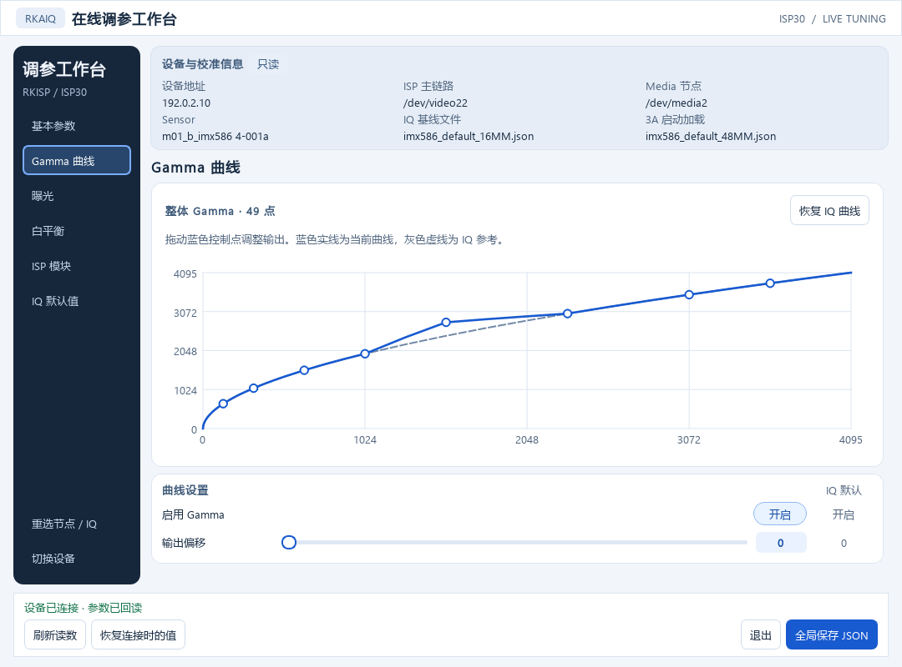
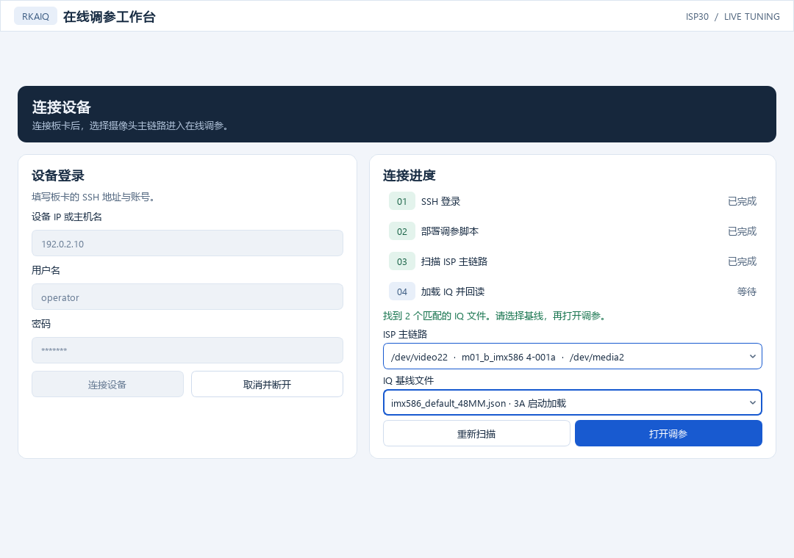
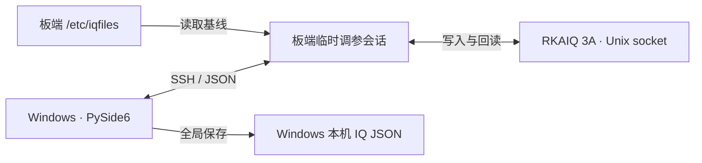

<div align="center">

# IQBench

**Rockchip RK3588 · ISP30 在线调参工作台**

在 Windows 上连接板卡，搭配现有的采集窗口观察调参效果，再把确认的改动导出为一份完整的 IQ JSON。


[快速上手](#快速上手) · [可调参数](#可调参数) · [开发与打包](#开发与打包)

</div>



*界面截图使用演示设备地址和参数。*

## 为什么用它

- **从实际出图的链路开始。** 扫描板卡的 Media 拓扑，只列 RKISP `mainpath`，选中节点后即可看到 Sensor 和对应的 IQ 文件。
- **同一个节点可以换镜头基线。** 应用优先预选 3A 启动日志确认的 IQ 文件，也允许手动选择同一 Sensor 的其他 JSON。工作台分别标明所选基线和 3A 启动加载的文件。
- **拖动有回读，保存有据可查。** 设备回读决定滑块位置，IQ 文件提供参考值。全局保存只把本次已确认且偏离进入会话时设备值的改动回填到所选模板。

### 一个亮度例子

| 操作 | IQ 默认值 | 工作台读数 |
| --- | ---: | ---: |
| 打开调参，回读设备 | 128 | 150 |
| 拖动亮度，设备确认 | 128 | 170 |

点击 **全局保存 JSON** 后，新文件的亮度字段写入 `170`。完整 JSON 保存到你指定的本机路径，由你决定何时替换板卡上的 IQ 文件。

## 快速上手

1. 完整解压 `RKAIQWorkbench-win-x64.zip`，从解压目录双击 `RKAIQWorkbench.exe`。Python、Qt 和 SSH 客户端随便携包提供。也可从源码 [自行打包](#开发与打包)。
2. 填写板卡的 SSH 地址和账号，点击 **连接设备**。右侧会显示登录、脚本部署和拓扑扫描进度。
3. 选择 **ISP 主链路** 和 **IQ 基线文件**，点击 **打开调参**。在现有的采集或推流窗口观察画面，确认满意后导出。

板端需已启动 `rkaiq_3A.service`，在 `/etc/iqfiles` 提供对应的 ISP30 校准文件，并可通过 SSH 访问。调参会话使用板端的 `python3`（3.10+）和 `media-ctl`。

<details>
<summary>查看连接向导</summary>



</details>

## 可调参数

| 页面 | 支持的调节项 |
| --- | --- |
| 基本参数 | 亮度、对比度、饱和度、色相、黑白模式与 CPROC |
| Gamma 曲线 | 整体 49 点曲线、控制点拖动、输出偏移与恢复 IQ 曲线 |
| 曝光 | 自动或手动曝光、快门时间、模拟增益、曝光补偿与防频闪 |
| 白平衡 | 自动或手动模式、色温、光源预设、R / Gr / Gb / B 增益 |
| ISP 模块 | RAW 空域与时域降噪、YNR、CNR、锐化、坏点校正、BLC、DRC、去雾与 3D LUT 等 |

调参控件根据所选 IQ 与设备的实际回读启用。可在 **IQ 默认值** 页查看 `normal/day` 场景中的文件基线。

## 实测环境

| 项目 | 已验证配置 |
| --- | --- |
| 桌面端 | Windows 11 Pro x64，验证过便携包从含中文和空格的目录启动 |
| 板卡 | RK3588 HYEO V30，Debian 12 aarch64，内核 `6.1.99-rk3588` |
| ISP / RKAIQ | ISP30，RKISP 驱动 `v02.09.00`，RKAIQ `v6.0x9.0` |
| 实机链路 | IMX586 → `/dev/media2` → `/dev/video22`（`rkisp_mainpath`） |

已实测亮度写入和回读、Gamma 曲线拖动、JSON 导出及退出清理。干净的 Windows 11 家庭版待独立验收。

## 工作原理



桌面端合并短时间内同一参数的改动，一次只发送一条待回读请求。板端脚本运行在 `/tmp/rkaiq-panel-*`，正常退出或切换设备时，应用等待板端清理确认。

| 路径 | 职责 |
| --- | --- |
| [`rkaiq_desktop/`](rkaiq_desktop/) | Qt 界面、异步 SSH 会话、调参与本机保存 |
| [`board/`](board/) | Media 探测、IQ 匹配、RKAIQ socket 和参数回填 |
| [`tools/board/`](tools/board/) | 板端 Sensor 路由维护工具 |
| [`packaging/`](packaging/) | Windows x64 打包、发布说明和第三方许可 |

## 开发与打包

在 Windows 开发机安装 Python 3.12 x64，从项目根目录执行以下命令。

```powershell
py -3.12 -m venv .venv
.\.venv\Scripts\python.exe -m pip install -r requirements-build.txt
.\.venv\Scripts\python.exe launch.py
.\packaging\build.ps1
```

打包生成 `dist/RKAIQWorkbench-win-x64.zip`。日常开发也可双击 [`start_rkaiq_panel.cmd`](start_rkaiq_panel.cmd)。

如需预填设备信息，可在源码根目录或便携 EXE 同目录放置 `device.local.json`，使用 `host`、`user`、`password` 三个字符串字段。该文件保留在本机。

## 交流与反馈

**如果 IQBench 帮你更快确认了一组 ISP 参数，欢迎点右上角 ⭐ Star，方便下次调试时找到它。**

欢迎在 Issue 里分享板卡和镜头组合。反馈问题时，附上 SoC、ISP/RKAIQ 版本、Sensor、`mainpath` 节点和复现步骤，方便定位。

## 第三方组件

RKAIQ 参考源码及便携包依赖的许可和来源见下列资料。[RKAIQ 参考源码](https://github.com/TaishanPi-Rockchip/linux.external.camera_engine_rkaiq) · [第三方许可与源码说明](packaging/THIRD-PARTY.txt)
